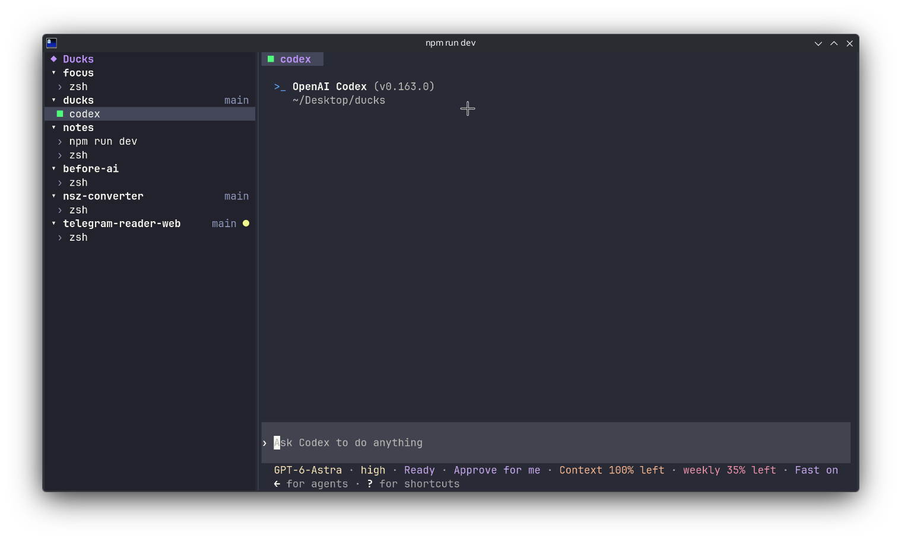
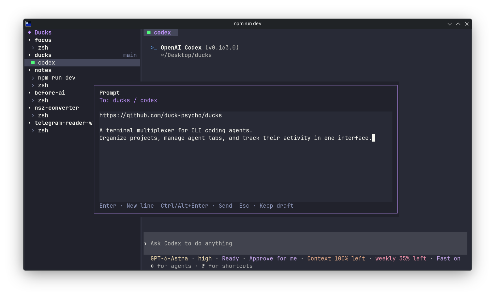
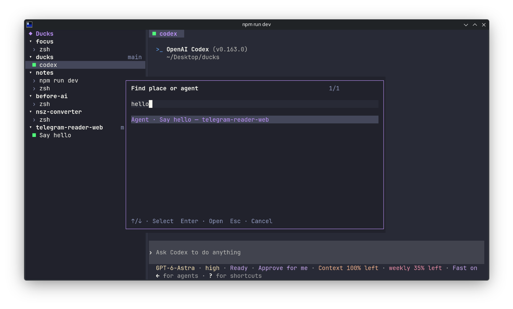
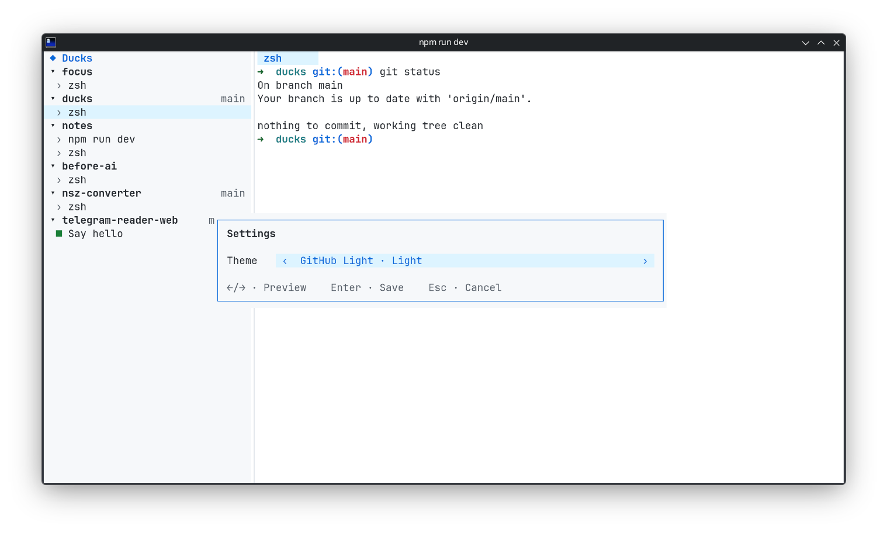

# Ducks

A terminal multiplexer for CLI agents. Organize working directories into Places, run agents in separate tabs, and see their activity status in one interface.

<p align="center">
  
</p>

*The screenshots show the real Ducks interface with prepared demo sessions and agent output.*

## Requirements

- Linux or macOS, Node.js ≥22.13, and npm.
- An interactive terminal of at least 80×24 cells.
- CLI agents installed and authenticated separately.

Installing `node-pty` may require Python and C++ build tools (Xcode Command Line Tools on macOS).

## Run

From the project directory:

```sh
npm install
npm start -- --place /path/to/project
```

`npm install` builds the application automatically. In the opened shell, run your agent command, such as `codex` or `claude`.

Press `Ctrl+B`, then `a` to open another terminal, `s` to add a Place, `?` for help, or `q` to quit.

Git branches in the sidebar show `●` for uncommitted changes (including untracked files) and `↑N` for commits ahead of the upstream branch. `↑?` means the upstream count is unavailable. Status refreshes every second using local Git data; Ducks does not fetch from remotes.

To run directly from source during development:

```sh
npm run dev -- --place /path/to/project
```

After changing source files, run `npm run build` before using `npm start` again.

## Features in action

### Multiline prompts

Press `Ctrl+B`, then `p` to compose a prompt for the selected agent. Use `Ctrl+Enter` or `Alt+Enter` to send it, or `Esc` to keep the draft for later.

<p align="center">
  
</p>

### Find Places and agents

Press `Ctrl+B`, then `f` to search across Places and agent thread names. Select a result and press `Enter` to focus its terminal.

<p align="center">
  
</p>

### Dark and light themes

Press `Ctrl+B`, then `m` to preview six built-in themes. Use the arrow keys to switch, `Enter` to save, or `Esc` to restore the previous theme.

<p align="center">
  
</p>
